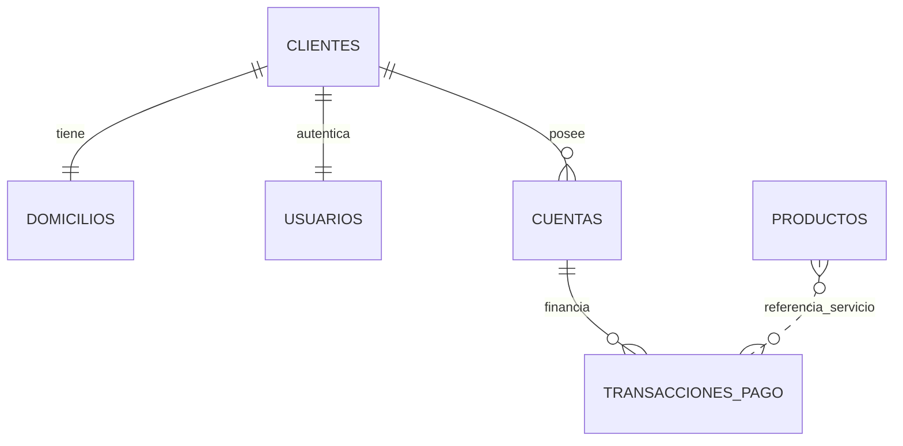

# Documento Técnico — Plataforma de Pagos de Servicios PuntoRed / GestoPago

**Proyecto:** `PuntoRed_Prueba_MAAI-GIDS6102`  
**Arquitectura:** Monorepo multiplataforma (Backend Spring Boot + Web React + Móvil Flutter)

---

## 1. Visión General y Principios de Diseño

La plataforma integra el flujo completo de **Puntored Servicios H2H - V2** (`https://services.preprodcxr.co/puntored/api/v1`) junto con la compatibilidad previa de **GestoPago (`SenTx`)** y el módulo de **Onboarding de Clientes, Cuentas 18 dígitos y Seguridad JWT/2FA**.

Se garantizan los siguientes principios en **Web (`frontend/`)** y **Móvil (`mobile_flutter/`)**:
1. **Identidad unificada Web ↔ Móvil:** Un usuario registrado con sus credenciales accede exactamente a los mismos datos, cuentas, catálogos y transacciones en ambos clientes (`POST /auth/login`, `POST /clientes`, `POST /auth/logout`).
2. **Sin `@PathVariable` ni `@RequestParam`:** Todos los endpoints de negocio reciben DTOs validados con `@Valid @RequestBody`.
3. **Secretos externalizados:** Ninguna llave criptográfica, contraseña de base de datos ni credencial de API se almacena en texto claro dentro del código fuente (`application.properties` delega a variables de entorno y/o `application-local.properties` ignorado en `.gitignore`).
4. **Control de estado financiero estricto:** Ninguna operación se marca como `EXITOSA` sin confirmación explícita del proveedor. Los casos inciertos se registran como `PENDIENTE` o `NO_CONFIRMADA` y los rechazos como `RECHAZADA`.

---

## 2. Arquitectura por Capas del Backend (`src/main/java/com/proyecto/servicios/`)

| Capa | Responsabilidad | Componentes principales |
|---|---|---|
| **Controllers** | Exposición REST + validación `@Valid @RequestBody` + guardias JWT | `AuthController`, `ClienteController`, `AdminController`, `CuentaController`, `CuentaUsuarioController`, `CatalogoController`, `PuntoredPagoController`, `PagoController`, `ProductoController` |
| **Config & Security** | Token JWT (`JJWT`), interceptores de sesión por inactividad, propiedades externalizadas | `SeguridadGuard`, `ActividadSesionInterceptor`, `PuntoredProperties`, `ConfigDB`, `WebConfig` |
| **Clients** | Consumo HTTP hacia API Puntored H2H V2 con timeouts configurables | `PuntoredApiClient`, `PuntoredHttpResult` |
| **Services** | Lógica de negocio, caché Redis con fallback, generación de tokens firmados AES-GCM, control 2FA y estado transaccional | `PuntoredTokenServiceImpl`, `PuntoredCatalogoServiceImpl`, `PuntoredPagoServiceImpl`, `ClienteServiceImpl`, `CuentaServiceImpl`, `PagoServiceImpl`, `UsuarioServiceImpl`, `ProductoCacheService` |
| **Exceptions** | Manejo centralizado `@RestControllerAdvice` y catálogo estandarizado de códigos | `GlobalExceptionHandler`, `MensajeError`, `ValidacionException` |
| **Persistence** | Entidades JPA + repositorios + especificaciones dinámicas | `Cliente`, `Domicilio`, `Cuenta`, `Usuario`, `TransaccionPago`, `Producto`, `GestoPagoToken` |

---

## 3. Modelo de Base de Datos y Migraciones Flyway

Ubicación de migraciones: [`src/main/resources/db/migration/`](file:///c:/Hasani/PuntoRed_Prueba_MAAI-GIDS6102/src/main/resources/db/migration).

| Migración | Contenido principal |
|---|---|
| `V1__create_gestopago_tokens.sql` | Tabla `gestopago_tokens` para persistir token de sesión GestoPago. |
| `V2__create_personas.sql` / `V8__elimina_personas.sql` | Tabla transitoria inicial `personas` y su retiro al consolidar en `clientes`. |
| `V3__create_productos.sql` | Tabla `productos` para catálogo sincronizado de servicios. |
| `V4__onboarding_clientes.sql` | Tablas `clientes`, `domicilios`, `cuentas`, `usuarios`. |
| `V5__agrega_rol_usuarios.sql` | Columna `rol` en `usuarios` (`1 = ADMIN`, `2 = USUARIO_NORMAL`). |
| `V6__catalogos_cerrados_y_longitud_nombre.sql` / `V7__catalogos_paises_nacionalidades.sql` | Catálogos cerrados de estado civil, países y nacionalidades. |
| `V9__cuentas_18_caracteres_y_2fa_pagos.sql` | Cuentas bancarias de 18 dígitos (`numero_cuenta`) y tabla `transacciones_pago` con verificación 2FA por correo. |
| `V10__puntored_catalogo_e_historial_pagos.sql` | Agrega `logo_url`, `descripcion`, `categoria`, `codigo_proveedor`, `tipo_operacion` en `productos`; amplía `transacciones_pago` con `estado` (`EXITOSA`, `RECHAZADA`, `PENDIENTE`, `NO_CONFIRMADA`), `nombre_servicio`, `nombre_producto`, `categoria`, `logo_url`, `referencia_secundaria`, `trace`, `ticket_json`, `proveedor`, `codigo_producto_externo`, `codigo_convenio_externo` e índices por cuenta/trace/fecha. |
| `V11__enable_rls_public_tables.sql` | Habilita Row Level Security (`ENABLE ROW LEVEL SECURITY`) en todas las tablas del esquema `public` como defensa en profundidad cuando se aloja en PostgreSQL administrado (Supabase). |

---

## 4. Seguridad, Cifrado y Manejo de Secretos

1. **Correo electrónico en BD (`Usuario`):** Se guarda cifrado con **AES-256-GCM** usando IV aleatorio por registro (`CryptoUtil`) acompañado de un índice hash **SHA-256** (`HashUtil`) para búsquedas sin descifrado masivo.
2. **Contraseñas y PIN 2FA:** Hash **BCrypt** para contraseñas de acceso; código temporal 2FA de 6 dígitos hasheado con **SHA-256** enviado por correo (`POST /pagos/enviar-pin`).
3. **JWT propio (`JwtUtil`) + Sesiones por inactividad (`ActividadSesionInterceptor` y `SesionExpiracionScheduler`):**
   - Claims de `clienteId` y `rol`.
   - Token guardado cifrado en `usuarios.jwt_cifrado`.
   - Tanto React (`AuthContext.tsx`) como Flutter (`AppState` / `ApiService`) interceptan respuestas HTTP `401` / código `9` y programan cierre automático al vencer `expiraEnSegundos`.
4. **Token de validación de referencia (`PuntoredPagoServiceImpl`):** Al validar una referencia exitosamente, el servidor firma un payload JSON (tipo operación, referencia, convenio/producto, rangos de monto y timestamp de expiración) con **AES-256-GCM**. El endpoint `POST /pagos/puntored` verifica que ese `tokenValidacion` pertenezca al mismo servicio/referencia y no haya expirado (`EXPIRACION_TOKEN_VALIDACION_SEGUNDOS = 900`), bloqueando pagos sin validación previa.

---

## 5. Flujo PuntoRed H2H V2 (Catálogo → Validación → Pago → Historial)

### 5.1 Catálogo Dinámico (`CatalogoController`)
- **`GET /api/catalogo`** y **`POST /api/catalogo/buscar`** (`CatalogoBusquedaRequest`):
  - Consume dinámicamente los módulos H2H V2 de PuntoRed (Recargas, Paquetes, Recaudos V1/V2 y Pines Digitales) junto con logotipos oficiales, descripciones, categorías y saldo de comercio.
  - Almacena snapshot en Redis (`puntored:catalogo:snapshot:v1`) con respaldo automático en memoria si Redis no está disponible.

### 5.2 Validación de Referencia (`POST /pagos/validar-referencia`)
- Recibe `ValidarReferenciaRequest` (`tipoOperacion`, `idConvenio`, `codigoProducto`, `codigoProveedor`, `referencia1`, `referencia2`, `montoReferencia`, `codigoIac`, etc.).
- Valida formato esperado (por ejemplo celular de 10 dígitos en recargas/paquetes o referencia general) y consulta el endpoint de consulta de PuntoRed correspondiente.
- Retorna `ValidacionReferenciaResponse`: `referenciaValida`, `tokenValidacion`, `opciones` de monto devueltas por el convenio, rango `montoMinimo`/`montoMaximo`, `montoEditable` y `camposAdicionalesAval`.

### 5.3 Confirmación Explícita y Ejecución de Pago (`POST /pagos/puntored`)
- Exige en `PagoPuntoredRequest`:
  - `confirmacionExplicita == true` (código 33 si falta).
  - `tokenValidacion` vigente (código 28 si es inválido/alterado/expirado).
  - `pin2fa` válido de 6 dígitos emitido para la cuenta de 18 dígitos.
- Diferencia explícitamente los resultados:
  - **`EXITOSA`**: Respuesta confirmada por el proveedor; incluye `codigoAutorizacion`, `idTransaccionProveedor`, `trace`, descuento de saldo real y `ticket`.
  - **`RECHAZADA`**: Respuesta denegada por el proveedor o fondos insuficientes.
  - **`PENDIENTE` / `NO_CONFIRMADA`**: Timeout o respuesta ambigua de red/proveedor; **no** se presenta como exitosa al usuario y permite re-verificación posterior.

### 5.4 Historial y Re-verificación (`POST /pagos/historial` y `POST /pagos/detalle`)
- **`POST /pagos/historial`** (`HistorialPagosRequest`): Filtra automáticamente por `infoToken.getClienteId()` para usuarios normales (o por `numeroCuenta` para admin), garantizando aislamiento estricto de operaciones por usuario autenticado.
- **`POST /pagos/detalle`** (`DetallePagoRequest`): Devuelve información completa y ticket digital; cuando `consultarEstadoProveedor=true`, consulta el estado actual de transacciones `PENDIENTE` / `NO_CONFIRMADA` por `trace`.

### 5.5 Cuentas Propias (`GET /cuentas/mias`)
- Implementado en `CuentaUsuarioController`: entrega únicamente las cuentas `ACTIVA` del usuario autenticado (o todas las cuentas activas si `rol == 1`).

---

## 6. Clientes Frontend Web y Móvil Flutter

| Capacidad | Web (`frontend/`) | Móvil (`mobile_flutter/`) |
|---|---|---|
| **Tecnología** | React 18 + TypeScript + Vite 6 + Bootstrap 5 | Flutter 3.50.0 + Dart 3.14.0 + Material 3 |
| **Autenticación** | `AuthPage.tsx` + `AuthContext.tsx` | `auth_screen.dart` + `app_state.dart` |
| **Catálogo con logos/categorías** | `ProductosPage.tsx` + `ServiceLogo.tsx` | `catalog_screen.dart` + `ServiceLogoWidget` |
| **Wizard 4 pasos (Referencia obligatoria + Modal Confirmación + PIN 2FA)** | `PagosPage.tsx` | `payment_screen.dart` |
| **Historial autenticado + Tirilla + Re-consulta** | `HistorialPage.tsx` | `history_screen.dart` |
| **Mis Cuentas y Abonos** | `CuentasPage.tsx` | `accounts_screen.dart` |
| **Gestión de Clientes (Admin)** | `ClientesPage.tsx` | `clients_admin_screen.dart` |
| **Configuración entorno / Tema** | Selector URL + Bootstrap tema claro/oscuro | Diálogo URL (`Render` / `10.0.2.2` / `localhost`) + Material 3 Light/Dark |

---

## 7. Configuración Requerida y Variables de Entorno

Consultar la plantilla [`.env.example`](file:///c:/Hasani/PuntoRed_Prueba_MAAI-GIDS6102/.env.example) y [`src/main/resources/application.properties`](file:///c:/Hasani/PuntoRed_Prueba_MAAI-GIDS6102/src/main/resources/application.properties).

Variables obligatorias:
- `DB_URL`, `DB_USER`, `DB_PASSWORD`
- `GESTOPAGO_URL`, `GESTOPAGO_ID_DISTRIBUIDOR`, `GESTOPAGO_CODIGO_DISPOSITIVO`, `GESTOPAGO_PASSWORD`, `GESTOPAGO_AES_KEY`
- `PUNTORED_API_URL`, `PUNTORED_COMMERCE`, `PUNTORED_POS`, `PUNTORED_TERMINAL`, `PUNTORED_USERNAME`, `PUNTORED_PASSWORD`, `PUNTORED_TX_PASSWORD`
- `AES_LLAVE`, `JWT_LLAVE` (32+ bytes en Base64)
- `MAIL_HOST`, `MAIL_PORT`, `MAIL_USER`, `MAIL_PASS` (opcional en dev; sin SMTP válido los envíos 2FA se registran con respaldo controlado en logs en entorno local cuando aplique).
